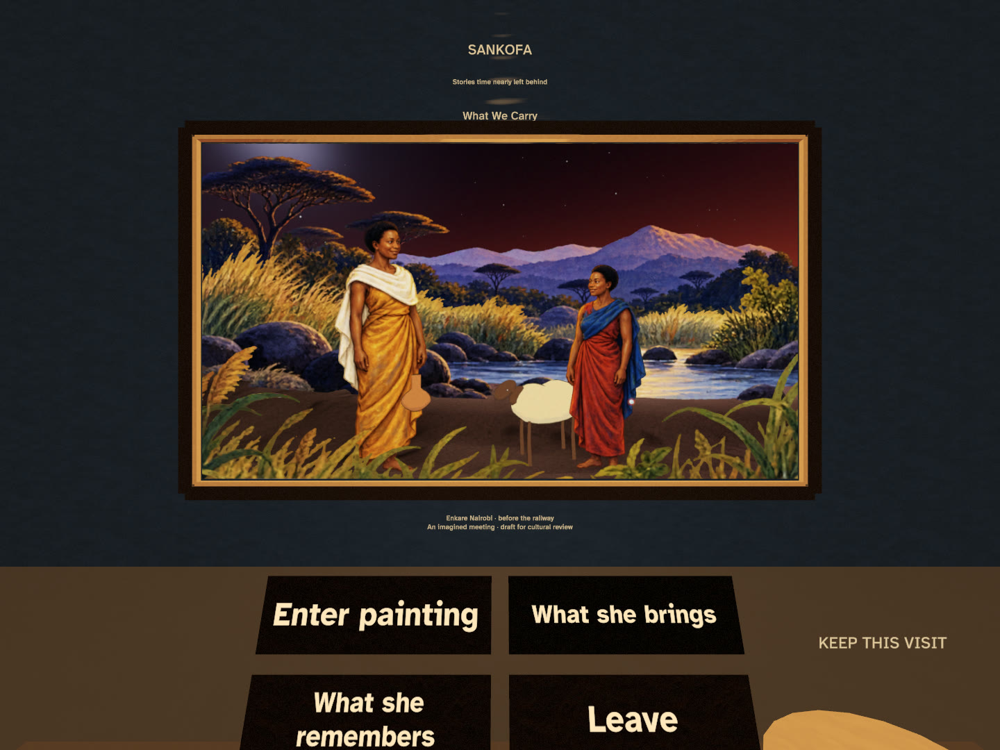
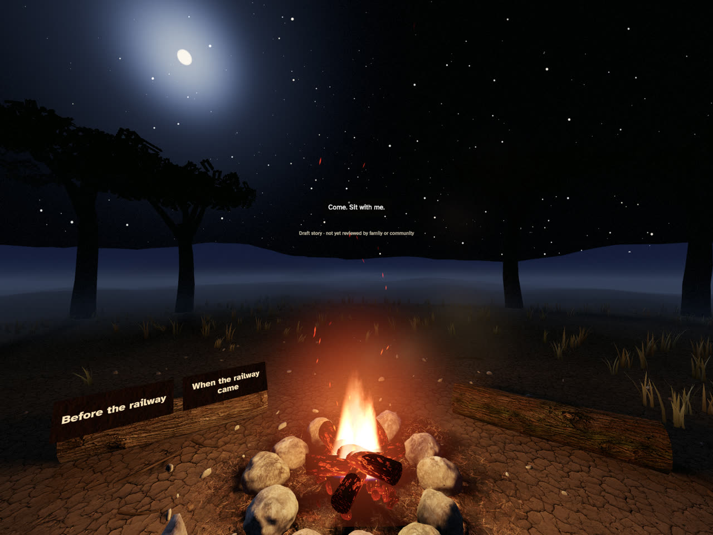
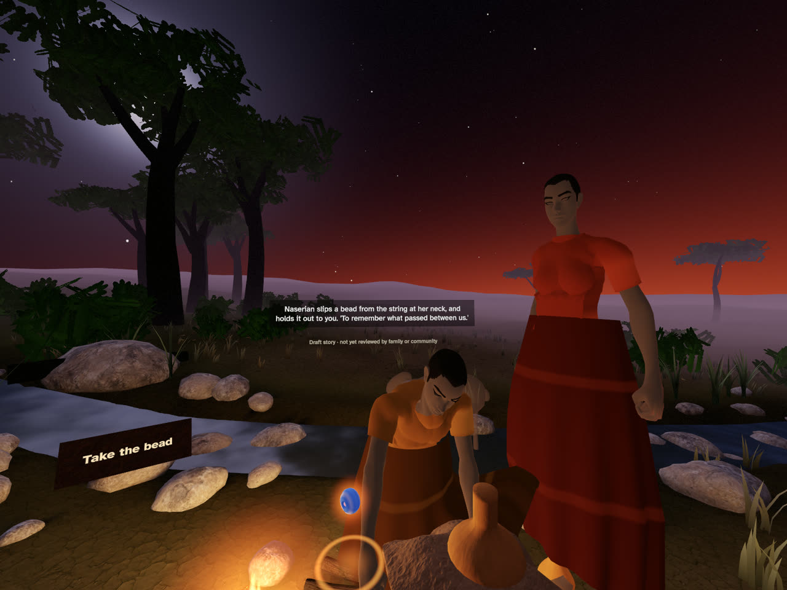
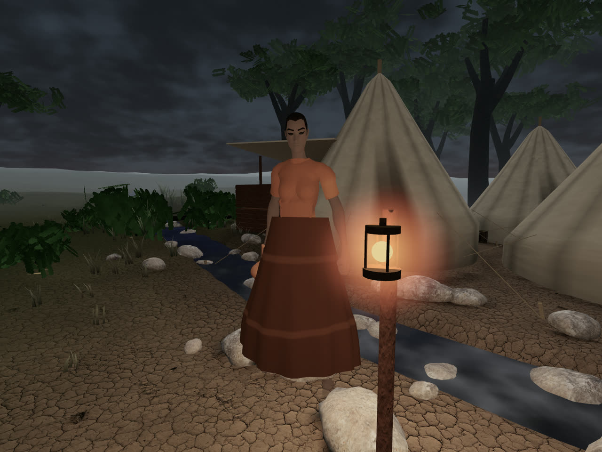
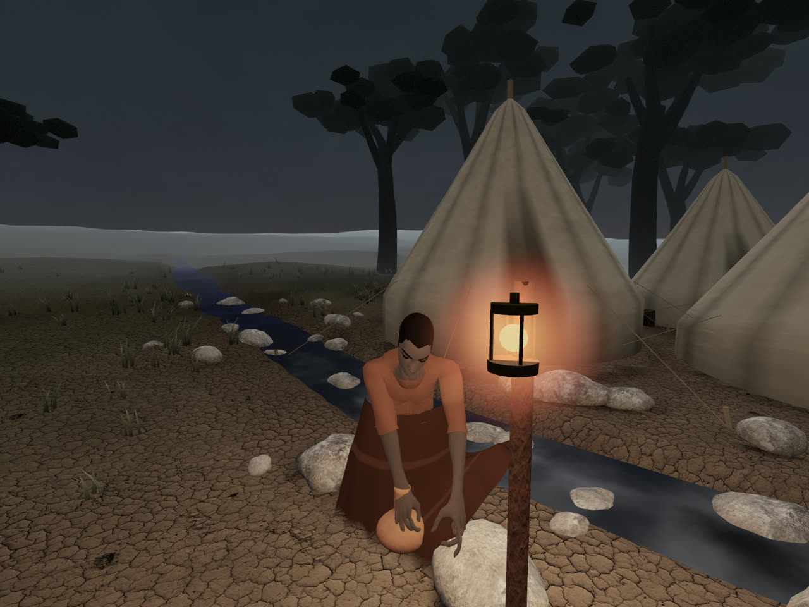
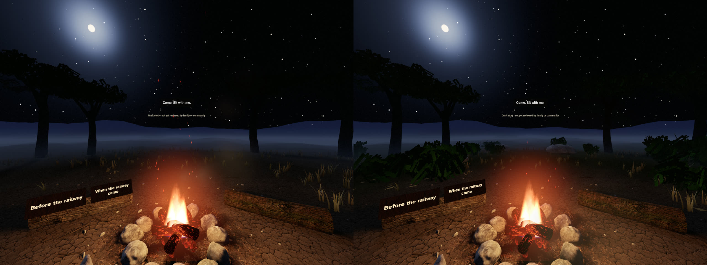

# SankofaVR

**Sankofa — Step inside the story.**

Sankofa focuses on stories time nearly left behind: everyday lives and relationships, made legible through specific cultural context and honest imaginative telling. Its living art gallery for Meta Quest lets you encounter a painting, enter its composition, experience a story that responds to your perspective and actions, then return to the same work understanding it differently. **What We Carry** is the first exhibit. The griot supplies context without revealing the story ahead of time; the fire remains its presence inside the artwork. Entry and exploration work while seated.

The [living gallery product scope](docs/product/illustrated-theatre-scope.md) guides the implementation. The new **LivingGallery** scene plays package v0.4.0: a framed view of the actual encounter, stationary entry/return, two authored revelations, explicit object questions, milk hospitality and a physical keepsake deposit. A saved visit offers the other perspective, replay or the painted modern river continuation. New narration is recorded and bundled. This is software/desktop evidence; device comfort/performance, cultural review and final art/listening acceptance remain open.

Open `unity/Assets/Sankofa/Scenes/LivingGallery.unity`. Scene generation and the review APK use `SankofaSceneBuilder.BuildLivingGallery` and `SankofaBuild.BuildLivingGallery`. The earlier theatre and 3D scenes below remain comparison records. There is no runtime story generation or live AI conversation.



[Remembered-meeting vignette](docs/media/gallery-remembered.jpg) · [Modern river continuation](docs/media/gallery-modern-river.jpg). These October 13 captures are muted desktop batch renders, not headset footage. Vignette art is a prototype; cast, garments, narration and cultural context still need review. The modern scene uses a draft OpenAI-generated painting with [exact prompt and provenance](unity/Assets/Sankofa/Art/IllustratedTheatre/modern-river-v1.sources.json).

The first setting is **Enkare Nairobi**, the water that gave Nairobi its name. Fictional encounters draw on the regional history of Kikuyu–Maasai trade. The baseline package visits two eras and today:

- before the railway, in the 1850s;
- when the railway came, in 1899;
- the same water today, opened by a keepsake from a kept visit.

Its facts come from a [source register](docs/content/enkare-nairobi/sources.md). Its people are fictional composites.

**SankofaVR** is the repository name; **Sankofa** is the product.

## Earlier illustrated-theatre MVP

The earlier comparison prototype tests a spatial illustrated theatre using the existing Unity foundation. Three painted scenic layers unfold at different depths. Wambui's physical gourd leaves her illustrated palm and comes within reach; receiving it changes her painted pose. Offering it to the trading hide changes both women using the same three-pose vocabulary. The fire, narration, tangible objects, hand input, passive path and opt-in keepsake/replay flow remain part of the experience.

Its story pass, **What We Carry** (package v0.3.0), follows an imagined meeting: Wambui brings less flour than promised, and Naserian remembers a time Wambui waited for her. The visitor can help or watch; their later address and remembered visit follow what actually happened. The modern coda lets the bead remain beside a passive visitor instead of placing it on a gate automatically. Read the [current script, response map and review questions](docs/content/enkare-nairobi/stories.md#current-illustrated-episode-what-we-carry). Remaining work is grouped in the [five-sprint proposal](docs/product/delivery-plan.md#current-sprint-plan). Historical context and invented encounters are distinguished in the telling; family/community review is still pending.


[Watch the gourd cross from the illustration into reachable space](docs/media/illustrated-handover.mp4).

These images and the silent hand-over preview were refreshed after the October 12 polish passes, using the v0.3.0 story. The animal is visible, tangible objects use warm painted pigments, and illustrated acknowledgement keeps the physical palm aligned with its card. The preview is a desktop runtime capture at a fixed 12 fps, with the flow driven by a test. It does not show actual hands or establish headset depth, comfort or performance. The cast and scenery are draft generated art; [full prompts and provenance](unity/Assets/Sankofa/Art/IllustratedTheatre/sources.json) are recorded. Cultural review is pending. The prototype covers the first historical chapter and its continuation; it has no runtime story generation or live conversation.

Open `unity/Assets/Sankofa/Scenes/IllustratedTheatre.unity`, or use the scene, simulator and APK commands in the [Unity guide](unity/README.md#commands). Spatial composition and response mappings live in [the theatre layout](unity/Assets/Sankofa/Content/illustrated-theatre-layout.json). The original `Hearth` scene is retained for comparison.

## Baseline Unity slice

Desktop renders from the seated eye, made by the capture test. They are not headset footage.

| | |
|---|---|
|  |  |
| The hearth, where the fire speaks | Before the railway: the stream at dusk |
|  |  |
| The bead is offered | When the railway came: the granddaughters |
|  |  |
| The same water today | Home, with the keepsake |


*Entering a story through the flame, left to right and top to bottom.*


*Home again: what the visitor lingered on rises out of the fire.*

## Figure revision


*Left: polish round 12 (`e3788de`). Right: the current scene, including the character, foliage and environment revisions. Both are actual desktop journey captures with the same camera framing.*

| Standing | Kneeling | Sharing |
|---|---|---|
|  |  |  |

*Close-up pose studies from the runtime, staged for inspection with captions hidden. These are presentation studies, not proof of visitor hand tracking or historical dress.*

## Animation revision

[Watch the approach, pour, acknowledgment and return](docs/media/exchange-performance.mp4).


*A silent 22-second runtime study, captured at a fixed 12 frames per second with the story controls hidden. This shows calibrated walking pace, stance-foot correction and coordinated handling after both figures animate. It is staged presentation evidence, not headset footage or a performance benchmark. Kneeling now holds a resting pose rather than repeating the library's repair action. Dedicated turn steps, expressive faces and bespoke acting remain unfinished.*

## Environment revision




*Left: round 13 (`a52337a`). Right: the current environment pass. Both panels use actual desktop journey captures with the same seated camera framing. Shrubs, fallen limbs, leaf litter and outcrops frame the clearing; organic ground cover and bank vegetation replace the uniformly parched river edge. The camp gains stores and today gains planted beds. These are authored reconstructions awaiting context and device review.*


*A seated view toward the camp's stores, staged in the runtime with story objects and captions hidden for environment inspection. This is a presentation study, not visitor or device evidence.*

## Status

The full slice runs in software: a Unity project for Quest and an engine-free story core.

| Piece | State |
|---|---|
| Story | Both eras and today are written, validated on every route, and narrated in 85 pre-rendered lines |
| Interaction | Hands throughout: an open palm, touch, fingertip presses, or point and pinch. Touch controllers are optional |
| Visits | A start screen, passive progression, questions and pause. Visits are kept only by explicit choice, and can replay the same path and outcomes, continue to today or be forgotten; questions and interruption timing are not replayed |
| Figures | Complete skinned tops and wraps, calibrated walking with stance-foot correction, kneeling rest, coordinated gourd sharing, held-object finger poses, blinks, and a glance when your attention rests on them |
| Sound | Field recordings (CC0 and CC BY, credited in the app). Nothing is synthesised, and there is no music |

Not yet established:
- **Hardware:** nothing has run on a headset or in the simulator with hand tracking, and no participant has tried it.
- **Review:** the stories have not been reviewed by family or community, and some claims are held back until verified.
- **Language:** a second language is not chosen.

The planned entry is Adapted / Significantly Updated Entertainment. AI-generated music is excluded.

## Try it

On a headset, follow the [testing guide](docs/product/testing-guide.md): a ten-minute walkthrough with hands. From source, run these from the repository root. The Unity commands need Unity 6000.3.25f1 through Unity Hub; full details are in the [Unity README](unity/README.md).

```sh
# Story core, flow, gestures and storage, with no Unity needed (.NET 10 SDK)
dotnet test dotnet/Sankofa.Tests

# Play the hearth in the Meta XR Simulator (aim with the mouse and click to choose)
"/Applications/Unity/Hub/Editor/6000.3.25f1/Unity.app/Contents/MacOS/Unity" -projectPath "$PWD/unity" -buildTarget Android -executeMethod Sankofa.EditorTools.SankofaSimulator.PlayHearth

# Documentation links and local-only exclusions
python3 scripts/check_workspace.py
```

## Repository map

```text
docs/                    Product, engineering, content and provenance documents (start at docs/README.md)
dotnet/                  .NET build and tests of the engine-free modules (CI runs these)
scripts/                 Workspace check, narration generation, recording preparation, the README gallery
unity/                   The Quest application
  Assets/Sankofa/
    Core/ Flow/ Interaction/ Storage/   Engine-free story rules, application flow, gestures, kept visits
    Runtime/             Presentation, input, audio and composition in Unity
    Editor/              Generated scenes and materials, import settings, build and build guards
    Content/             The Enkare Nairobi story package, narration manifest and credits
    Art/                 Shaders, generated assets, scanned materials, field recordings, fonts
    Resources/Narration/ The griot's pre-rendered voice
    Tests/               EditMode and PlayMode tests
references/              Index of official competition and original web Sankofa sources
AGENTS.md                Working instructions for people and agents
```

## Documentation

See the [documentation index](docs/README.md). The most used documents are:
- [product requirements](docs/product/prd.md);
- [decisions](docs/decisions.md);
- [backlog](docs/backlog.md);
- [architecture](docs/architecture.md);
- [development guide](docs/development.md);
- [asset register](docs/asset-register.md).

## Local-only material

The supplied rules, the description, the reference provenance and the original ideation chat are kept in the ignored `references/hackathon/` and `references/ideation/` folders. They are not included in GitHub or fresh clones.

`HACKATHON.local.md` is the local competition brief. Every working agent reads it, following [AGENTS.md](AGENTS.md). It is excluded from Git and from any application package. In a new checkout, follow [local competition setup](docs/development.md#local-competition-context); `python3 scripts/check_workspace.py --competition` confirms it is present.

Keep these out of Git:
- personal input;
- participant recordings;
- credentials;
- raw vendor downloads (in `vendor/`);
- generated builds (in `artifacts/`).

This repository is private, and no open-source licence has been selected. Reusing anything from the separate [web Sankofa project](https://github.com/Jeremiah-Sakuda/Sankofa) requires an explicit code and asset licensing decision.
