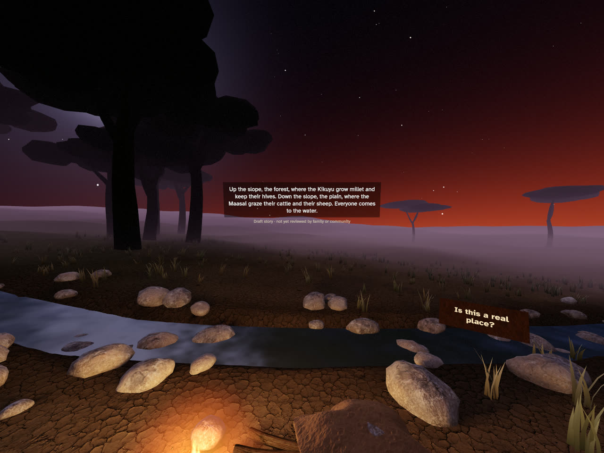
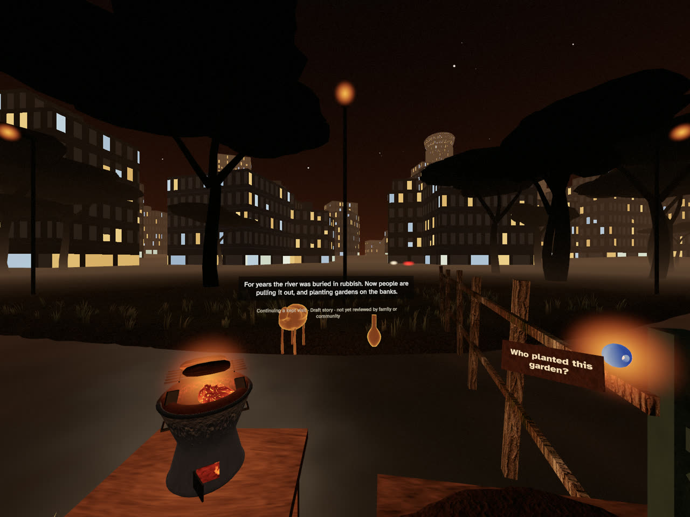

# SankofaVR

**Sankofa — a story that notices what you notice.**

A hands-first storytelling experience for Meta Quest. You sit at a night fire, and the fire is the griot. It welcomes you, asks when you would like to go, and brings a history into the space around you without moving you. You enter through its flame. People appear as shapes of firelight; you carry, receive and touch things, and the story changes with what you did. You return to the hearth with a keepsake and a thread to follow next time.

The first story is **Enkare Nairobi**, the cool-water stream that gave Nairobi its name, where Kikuyu and Maasai women traded. It is told across two eras and today:

- before the railway, in the 1850s;
- when the railway came, in 1899;
- the same water today, opened by a keepsake from a kept visit.

Its facts come from a [source register](docs/content/enkare-nairobi/sources.md). Its people are fictional composites.

**SankofaVR** is the repository name; **Sankofa** is the product.

## What it looks like

Desktop renders from the seated eye, made by the capture test. They are not headset footage.

| | |
|---|---|
|  |  |
| The hearth, where the fire speaks | Before the railway: the stream at dusk |
|  |  |
| The bead is offered | When the railway came: the granddaughters |
|  |  |
| The same water today | Home, with the keepsake |


*Entering a story through the flame, left to right and top to bottom.*


*Home again: what the visitor lingered on rises out of the fire.*

## Status

The full slice runs in software: a Unity project for Quest and an engine-free story core.

| Piece | State |
|---|---|
| Story | Both eras and today are written, validated on every route, and narrated in 85 pre-rendered lines |
| Interaction | Hands throughout: an open palm, touch, fingertip presses, or point and pinch. Touch controllers are optional |
| Visits | A start screen, passive progression, questions and pause. Visits are kept only by explicit choice, and can replay the same path and outcomes, continue to today or be forgotten; questions and interruption timing are not replayed |
| Figures | They walk in, kneel, carry their things, hand them over and walk away, and look back when you look at them |
| Sound | Field recordings (CC0 and CC BY, credited in the app). Nothing is synthesised, and there is no music |

Not yet established:
- **Hardware:** nothing has run on a headset or in the simulator with hand tracking, and no participant has tried it.
- **Review:** the stories have not been reviewed by family or community, and some claims are held back until verified.
- **Language:** a second language is not chosen.

The planned entry is Adapted / Significantly Updated Entertainment. AI-generated music is excluded.

## Try it

On a headset, follow the [testing guide](docs/product/testing-guide.md): a ten-minute walkthrough with hands. From source, run these from the repository root. The Unity commands need Unity 6000.3.25f1 through Unity Hub; full details are in the [Unity README](unity/README.md).

```sh
# Story core, flow, gestures and storage, with no Unity needed (.NET 10 SDK)
dotnet test dotnet/Sankofa.Tests

# Play the hearth in the Meta XR Simulator (aim with the mouse and click to choose)
"/Applications/Unity/Hub/Editor/6000.3.25f1/Unity.app/Contents/MacOS/Unity" -projectPath "$PWD/unity" -buildTarget Android -executeMethod Sankofa.EditorTools.SankofaSimulator.PlayHearth

# Documentation links and local-only exclusions
python3 scripts/check_workspace.py
```

## Repository map

```text
docs/                    Product, engineering, content and provenance documents (start at docs/README.md)
dotnet/                  .NET build and tests of the engine-free modules (CI runs these)
scripts/                 Workspace check, narration generation, recording preparation, the README gallery
unity/                   The Quest application
  Assets/Sankofa/
    Core/ Flow/ Interaction/ Storage/   Engine-free story rules, application flow, gestures, kept visits
    Runtime/             Presentation, input, audio and composition in Unity
    Editor/              Generated scenes and materials, import settings, build and build guards
    Content/             The Enkare Nairobi story package, narration manifest and credits
    Art/                 Shaders, generated assets, scanned materials, field recordings, fonts
    Resources/Narration/ The griot's pre-rendered voice
    Tests/               EditMode and PlayMode tests
references/              Index of official competition and original web Sankofa sources
AGENTS.md                Working instructions for people and agents
```

## Documentation

See the [documentation index](docs/README.md). The most used documents are:
- [product requirements](docs/product/prd.md);
- [decisions](docs/decisions.md);
- [backlog](docs/backlog.md);
- [architecture](docs/architecture.md);
- [development guide](docs/development.md);
- [asset register](docs/asset-register.md).

## Local-only material

The supplied rules, the description, the reference provenance and the original ideation chat are kept in the ignored `references/hackathon/` and `references/ideation/` folders. They are not included in GitHub or fresh clones.

`HACKATHON.local.md` is the local competition brief. Every working agent reads it, following [AGENTS.md](AGENTS.md). It is excluded from Git and from any application package. In a new checkout, follow [local competition setup](docs/development.md#local-competition-context); `python3 scripts/check_workspace.py --competition` confirms it is present.

Keep these out of Git:
- personal input;
- participant recordings;
- credentials;
- raw vendor downloads (in `vendor/`);
- generated builds (in `artifacts/`).

This repository is private, and no open-source licence has been selected. Reusing anything from the separate [web Sankofa project](https://github.com/Jeremiah-Sakuda/Sankofa) requires an explicit code and asset licensing decision.
