# SankofaVR

**Sankofa — For the stories you never got to hear.**

Bring a place name, an inherited fragment or a question. A warm griot, present as a small fire, guides an illustrated telling on a nearby table. Your curiosity changes the thread you explore. Historical context is sourced; imagined scenes remain labelled. Sankofa does not recover ancestors or invent a real relative's biography.

The [personal story table MVP](docs/product/personal-story-table-mvp.md) is the active direction. It combines hands-accessible typed input, an illustrated journal, contextual questions and explicit save/reopen. On compatible Quest hardware, passthrough and local table fitting aim to give the telling a place in the visitor's room; an adjustable virtual stand remains available. Unity integration is in progress, and actual room behaviour is device-unverified.

## Current status and source entry points

| Piece | Personal story table MVP |
|---|---|
| Coverage | Enkare Nairobi, Kenya, in the 1850s; journeys, trade/household, place/water; English |
| Personal input | Optional typed fragment or question; hands keyboard and explicit online consent; no identity or ancestry inference |
| Story | Three distinct authored bundled tellings; optional configured Google Gemini adapter for new reconstructed scenes within fixed historical context |
| Capability labels | `generated` only after an accepted provider result; unavailable/invalid generation is explicitly `bundled` or offers retry |
| Questions | Bounded contextual answers and source details; live conversation and voice input are deferred |
| Images and sound | Existing approved illustration IDs; dynamic image generation deferred; muted/caption-first verification, no AI-generated music |
| Memory | Explicit Keep, saved realised story, reopen without generation and deletion are being integrated with the new scene |
| Room | MRUK 207 table fitting and passthrough adapters with manual stand/recenter fallback; no room geometry sent to the story service |
| Evidence | 342 .NET checks pass at the core/service checkpoint; service fixtures and two actual public-synthetic Gemini responses pass actual .NET validation; final Unity integration checks and Quest/content acceptance remain open |

Historical text is restricted to C1/C6/C7 passages in the [source register](docs/content/enkare-nairobi/sources.md). Cultural and pronunciation acceptance remains pending. A citation or model-applied label cannot establish a new historical claim. Wider places, eras, second-language narration, dynamic images and live voice conversation remain deferred.

## Launch and verify the new scene

Generate `unity/Assets/Sankofa/Scenes/StoryTable.unity` with **Sankofa → Build Personal Story Table**, then open it in Unity. The builder is `SankofaSceneBuilder.BuildStoryTable`. Integration is still underway; the previous review APK and gallery captures below are not evidence for this scene. Check the [Unity guide](unity/README.md) for build/test tooling and the [current scope](docs/product/personal-story-table-mvp.md) for the acceptance gates.

From the repository root, the available core and scene-generation commands are:

```sh
dotnet test dotnet/Sankofa.Tests
python3 scripts/check_workspace.py --competition
"/Applications/Unity/Hub/Editor/6000.3.25f1/Unity.app/Contents/MacOS/Unity" -batchmode -noaudio -quit -projectPath "$PWD/unity" -buildTarget Android -executeMethod Sankofa.EditorTools.SankofaSceneBuilder.BuildStoryTable
```

The optional local service starts with `python3 -m backend.server` on loopback port 8787. Its credentials remain server-side; configuration examples are in [backend/.env.example](backend/.env.example). With no provider configured it returns an explicitly bundled response. A headset needs a separately reachable configured service; `localhost` on Quest refers to the headset. Do not expose a credential in the app or publish the development service as a production deployment. Provider access, retention and the deployed connection require their own verification. Local core composition remains available without a server.

The planned competition entry remains Adapted / Significantly Updated Entertainment, with eligibility, judge access, rights and device evidence pending. The [submission draft](docs/release/submission-draft.md) is editable local copy; no Devpost update or public submission has occurred.

## Earlier living-gallery candidate

The following records the October 13–15 gallery candidate and its earlier theatre/3D comparisons. These scenes, recordings, art and evidence are preserved. Their reported checks and APK identities apply to those builds, not the new personal story table.

**Sankofa — Step inside the story.**

Sankofa focuses on stories time nearly left behind: everyday lives and relationships, made legible through specific cultural context and honest imaginative telling. Its living art gallery for Meta Quest lets you encounter a painting, enter its composition, experience a story that responds to your perspective and actions, then return to the same work understanding it differently. **What We Carry** is the first exhibit. The griot supplies context without revealing the story ahead of time; the fire remains its presence inside the artwork. Entry and exploration work while seated.

The [living gallery product scope](docs/product/illustrated-theatre-scope.md) guides the implementation. The new **LivingGallery** scene plays package v0.7.0: a framed view of the actual encounter, stationary entry/return, two authored revelations, explicit object questions, milk hospitality and a physical keepsake deposit. A saved visit offers a focused memory revisit, replay of the saved telling or the painted modern river continuation. Narration cues now perform concern, divided provisions and remembered waiting; physical replacement saving requires a warning and second deposit. Existing narration is recorded and bundled. This is software/desktop evidence; device comfort/performance, cultural review and final art/listening acceptance remain open.

Open `unity/Assets/Sankofa/Scenes/LivingGallery.unity`. Scene generation and the review APK use `SankofaSceneBuilder.BuildLivingGallery` and `SankofaBuild.BuildLivingGallery`. The earlier theatre and 3D scenes below remain comparison records. There is no runtime story generation or live AI conversation.

The [October 14 production iteration](docs/reviews/2026-10-14-production-iteration.md) addresses carry state, logging, settings, return pacing and cast registration. The earlier [completion pass](docs/release/candidate.md) brought the passive agreement into the first five minutes of authored timing, refines focal props and protects captions from offered/carried objects. Current review packets, asset integrity evidence, Quest collection helper and an honest submission draft are prepared. External acceptance remains open; no sound playback or simulator is used in this pass.

The [October 15 simulator follow-up](docs/reviews/2026-10-15-gallery-input-and-layout.md) verifies manual simulated-controller selection, moves the wall context clear of entry/return controls and recovers initial placement when tracking arrives late. All simulator runs remain muted. These results do not replace actual Quest, real-hand or content acceptance.

The [October 15 museum pass](docs/reviews/2026-10-15-gallery-environment.md) now gives the exhibit a vaulted pavilion at dusk, open garden arcades, a star-visible roof spine, stone floor and refined frame. The architecture releases as the painting expands and returns with it; the visitor remains stationary. Controls have shallow physical plaque bodies.

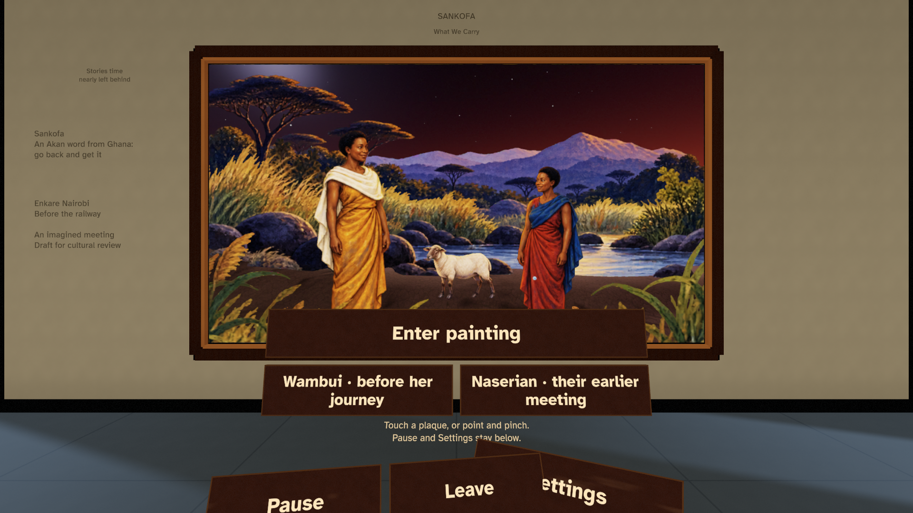

Current October 15 seated desktop render, with audio disabled; not headset footage. [Side-wall and ceiling view](docs/media/gallery-environment-side.png).

[Before the journey](docs/media/gallery-brings.png) · [Remembered-meeting vignette](docs/media/gallery-remembered.png) · [Keep guidance](docs/media/gallery-keep-guide.png) · [Modern river continuation](docs/media/gallery-modern-river.png). These October 14 v0.7 captures are muted desktop batch renders, not headset footage. The memory windows reuse painted scenery and cast, with time cues and labels. [Caption and memory clearance](docs/media/gallery-caption.png), [the named sheep](docs/media/gallery-sheep.png) and [a bead review close-up](docs/media/gallery-bead-detail.png) show this pass’s focal work. The close-up uses a review camera, not the seated view. Vignette art remains a prototype; cast, garments, narration and cultural context still need review. The modern scene uses a draft OpenAI-generated painting with [exact prompt and provenance](unity/Assets/Sankofa/Art/IllustratedTheatre/modern-river-v1.sources.json).

The first setting is **Enkare Nairobi**, the water that gave Nairobi its name. Fictional encounters draw on the regional history of Kikuyu–Maasai trade. The historical baseline package below visits two eras and today; the gallery candidate uses the first encounter with two memories and the modern coda:

- before the railway, in the 1850s;
- when the railway came, in 1899;
- the same water today, opened by a keepsake from a kept visit.

Its facts come from a [source register](docs/content/enkare-nairobi/sources.md). Its people are fictional composites.

**SankofaVR** is the repository name; **Sankofa** is the product.

### Gallery status and source entry points (historical)

| Piece | LivingGallery candidate |
|---|---|
| Story | One draft Kenyan encounter, Wambui's morning and Naserian's earlier meeting, plus a modern river coda; authored English recordings |
| Participation | Open-palm receive, touch, fingertip or point-and-pinch selection; truthful passive alternatives |
| Comfort | Visible pause/settings controls; modal preferences stop story time; text size, reduced motion, separate voice/ambience, caption-only narration, height/reach and recenter |
| Memory | Explicit local Keep with replacement confirmation, focused other-memory visit, replay and Forget; no per-action/journal logging |
| Presentation | Layered painted scenery/cast, registered poses and offered palms, tangible focal objects and miniature memories |
| Acceptance | Software/desktop evidence only; actual Quest, novice, cultural, pronunciation/listening and applicable rights/release acceptance remain open |

Replay preserves the saved realised text, retained recordings and resolved actions. It uses the current stage art/choreography; questions and interruption timing are excluded. It never generates replacement narration.

Open **`unity/Assets/Sankofa/Scenes/LivingGallery.unity`**. For this comparison, use the explicit **Build Living Gallery APK** command; the default build target may change with the active MVP. For silent source verification/building from the repository root:

```sh
dotnet test dotnet/Sankofa.Tests
python3 scripts/check_workspace.py --competition
python3 scripts/audit_gallery_assets.py
"/Applications/Unity/Hub/Editor/6000.3.25f1/Unity.app/Contents/MacOS/Unity" -batchmode -noaudio -quit -projectPath "$PWD/unity" -buildTarget Android -executeMethod Sankofa.EditorTools.SankofaSceneBuilder.BuildLivingGallery
"/Applications/Unity/Hub/Editor/6000.3.25f1/Unity.app/Contents/MacOS/Unity" -batchmode -noaudio -quit -projectPath "$PWD/unity" -buildTarget Android -executeMethod Sankofa.EditorTools.SankofaBuild.BuildLivingGallery
```

The generated APK is `artifacts/Sankofa-LivingGallery.apk`, kept local. Follow the [Unity guide](unity/README.md) for editor/runtime tests and the [device protocol](docs/testing/gallery-next-evidence-session.md) for actual hardware acceptance. The planned entry remains Adapted / Significantly Updated Entertainment; account/division confirmation is pending.

The following theatre and 3D records predate this gallery candidate.


## Earlier illustrated-theatre MVP

The earlier comparison prototype tests a spatial illustrated theatre using the existing Unity foundation. Three painted scenic layers unfold at different depths. Wambui's physical gourd leaves her illustrated palm and comes within reach; receiving it changes her painted pose. Offering it to the trading hide changes both women using the same three-pose vocabulary. The fire, narration, tangible objects, hand input, passive path and opt-in keepsake/replay flow remain part of the experience.

Its story pass, **What We Carry** (package v0.3.0), follows an imagined meeting: Wambui brings less flour than promised, and Naserian remembers a time Wambui waited for her. The visitor can help or watch; their later address and remembered visit follow what actually happened. The modern coda lets the bead remain beside a passive visitor instead of placing it on a gate automatically. Read the [current script, response map and review questions](docs/content/enkare-nairobi/stories.md#current-illustrated-episode-what-we-carry). Remaining work is grouped in the [five-sprint proposal](docs/product/delivery-plan.md#current-sprint-plan). Historical context and invented encounters are distinguished in the telling; family/community review is still pending.

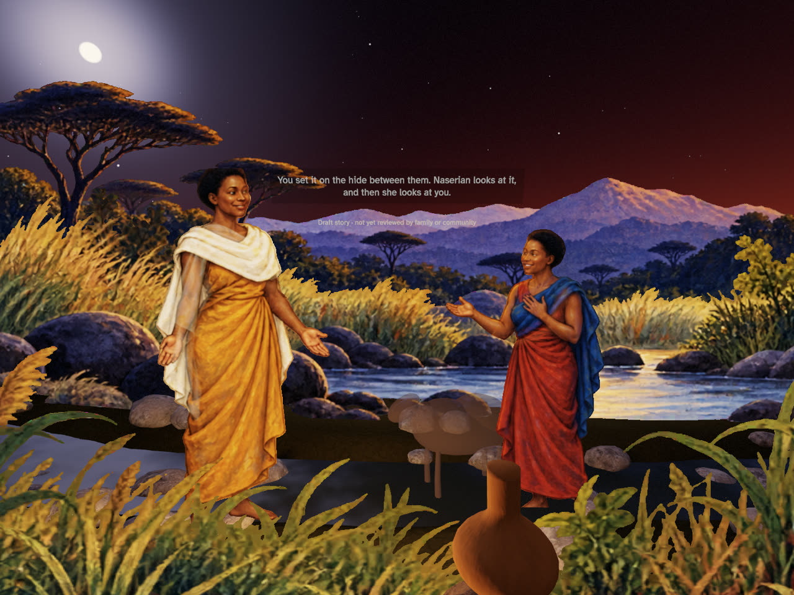

[Watch the gourd cross from the illustration into reachable space](docs/media/illustrated-handover.mp4).

These images and the silent hand-over preview were refreshed after the October 12 polish passes, using the v0.3.0 story. The animal is visible, tangible objects use warm painted pigments, and illustrated acknowledgement keeps the physical palm aligned with its card. The preview is a desktop runtime capture at a fixed 12 fps, with the flow driven by a test. It does not show actual hands or establish headset depth, comfort or performance. The cast and scenery are draft generated art; [full prompts and provenance](unity/Assets/Sankofa/Art/IllustratedTheatre/sources.json) are recorded. Cultural review is pending. The prototype covers the first historical chapter and its continuation; it has no runtime story generation or live conversation.

Open `unity/Assets/Sankofa/Scenes/IllustratedTheatre.unity`, or use the scene, simulator and APK commands in the [Unity guide](unity/README.md#commands). Spatial composition and response mappings live in [the theatre layout](unity/Assets/Sankofa/Content/illustrated-theatre-layout.json). The original `Hearth` scene is retained for comparison.

## Baseline Unity slice

Desktop renders from the seated eye, made by the capture test. They are not headset footage.

| | |
|---|---|
|  |  |
| The hearth, where the fire speaks | Before the railway: the stream at dusk |
|  | 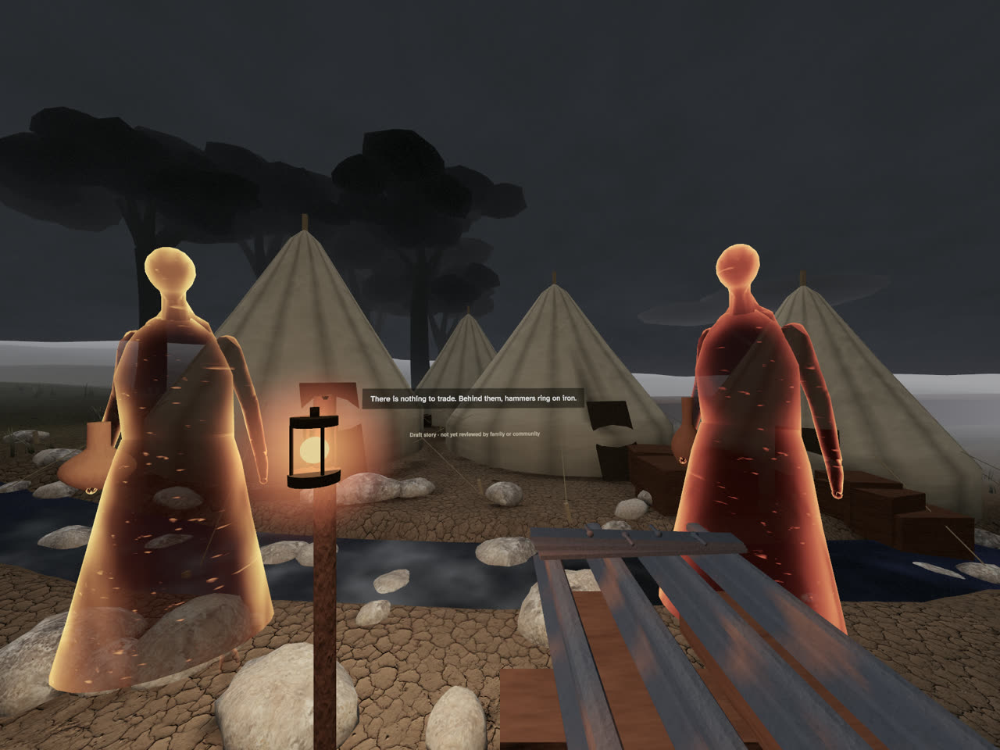 |
| The bead is offered | When the railway came: the granddaughters |
|  | 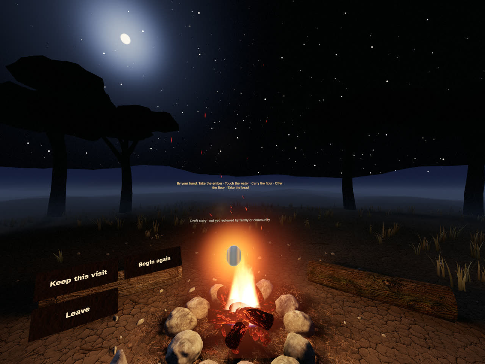 |
| The same water today | Home, with the keepsake |

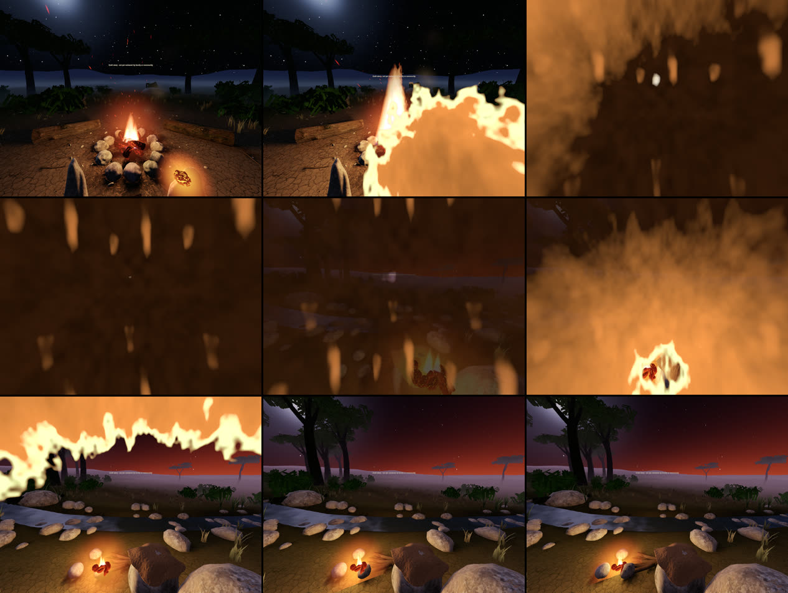

*Entering a story through the flame, left to right and top to bottom.*

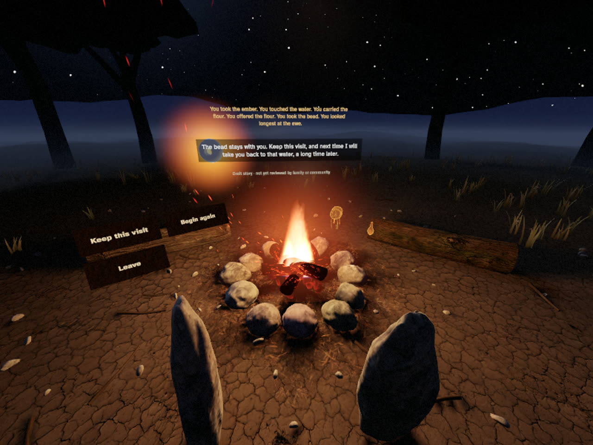

*Home again: what the visitor lingered on rises out of the fire.*

## Figure revision

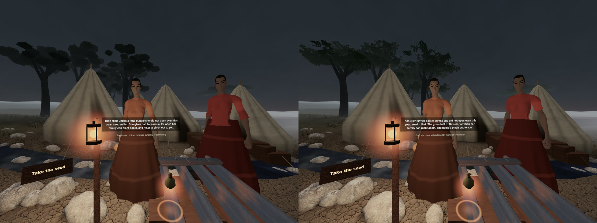

*Left: polish round 12 (`e3788de`). Right: the historical 3D comparison scene, including the character, foliage and environment revisions. Both are actual desktop journey captures with the same camera framing.*

| Standing | Kneeling | Sharing |
|---|---|---|
|  |  | 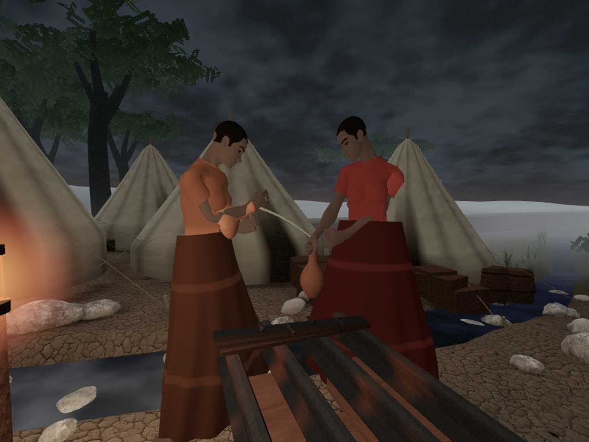 |

*Close-up pose studies from the runtime, staged for inspection with captions hidden. These are presentation studies, not proof of visitor hand tracking or historical dress.*

## Animation revision

[Watch the approach, pour, acknowledgment and return](docs/media/exchange-performance.mp4).

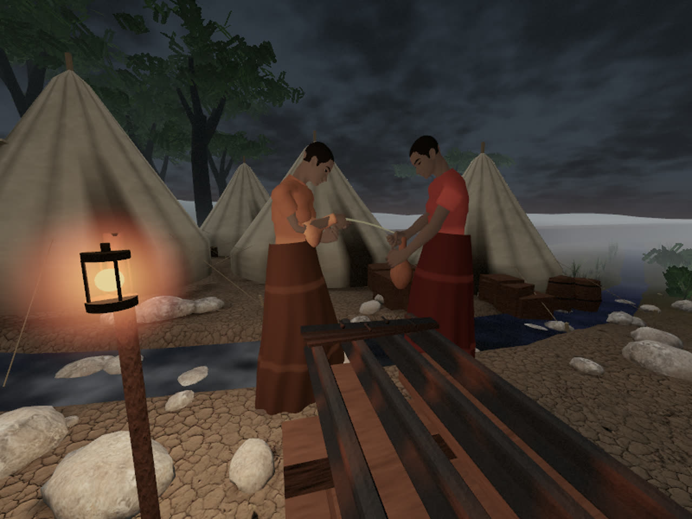

*A silent 22-second runtime study, captured at a fixed 12 frames per second with the story controls hidden. This shows calibrated walking pace, stance-foot correction and coordinated handling after both figures animate. It is staged presentation evidence, not headset footage or a performance benchmark. Kneeling now holds a resting pose rather than repeating the library's repair action. Dedicated turn steps, expressive faces and bespoke acting remain unfinished.*

## Environment revision


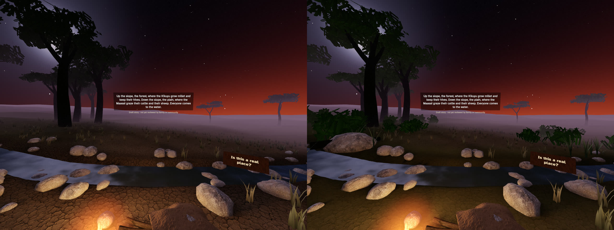

*Left: round 13 (`a52337a`). Right: the current environment pass. Both panels use actual desktop journey captures with the same seated camera framing. Shrubs, fallen limbs, leaf litter and outcrops frame the clearing; organic ground cover and bank vegetation replace the uniformly parched river edge. The camp gains stores and today gains planted beds. These are authored reconstructions awaiting context and device review.*

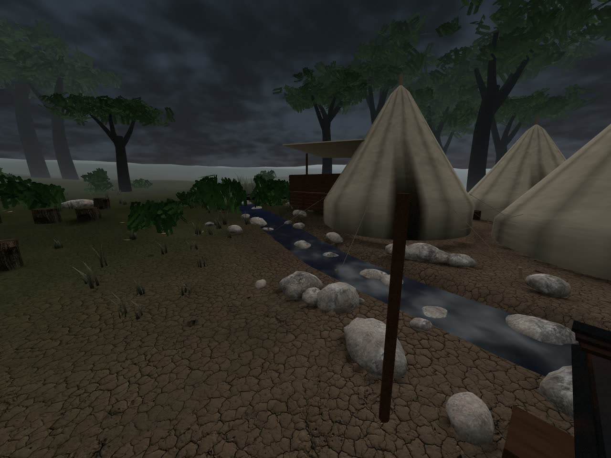

*A seated view toward the camp's stores, staged in the runtime with story objects and captions hidden for environment inspection. This is a presentation study, not visitor or device evidence.*

## Repository map

```text
docs/                    Product, engineering, content and provenance documents (start at docs/README.md)
dotnet/                  .NET build and tests of the engine-free modules (CI runs these)
scripts/                 Workspace check, narration generation, recording preparation, the README gallery
unity/                   The Quest application
  Assets/Sankofa/
    Core/ Flow/ Interaction/ Storage/   Engine-free story rules, application flow, gestures, kept visits
    Runtime/             Presentation, input, audio and composition in Unity
    Editor/              Generated scenes and materials, import settings, build and build guards
    Content/             The Enkare Nairobi story package, narration manifest and credits
    Art/                 Shaders, generated assets, scanned materials, field recordings, fonts
    Resources/Narration/ The griot's pre-rendered voice
    Tests/               EditMode and PlayMode tests
references/              Index of official competition and original web Sankofa sources
AGENTS.md                Working instructions for people and agents
```

## Documentation

See the [documentation index](docs/README.md). The most used documents are:
- [product requirements](docs/product/prd.md);
- [decisions](docs/decisions.md);
- [backlog](docs/backlog.md);
- [architecture](docs/architecture.md);
- [development guide](docs/development.md);
- [asset register](docs/asset-register.md).

## Local-only material

The supplied rules, the description, the reference provenance and the original ideation chat are kept in the ignored `references/hackathon/` and `references/ideation/` folders. They are not included in GitHub or fresh clones.

`HACKATHON.local.md` is the local competition brief. Every working agent reads it, following [AGENTS.md](AGENTS.md). It is excluded from Git and from any application package. In a new checkout, follow [local competition setup](docs/development.md#local-competition-context); `python3 scripts/check_workspace.py --competition` confirms it is present.

Keep these out of Git:
- personal input;
- participant recordings;
- credentials;
- raw vendor downloads (in `vendor/`);
- generated builds (in `artifacts/`).

This repository is private, and no open-source licence has been selected. Reusing anything from the separate [web Sankofa project](https://github.com/Jeremiah-Sakuda/Sankofa) requires an explicit code and asset licensing decision.
